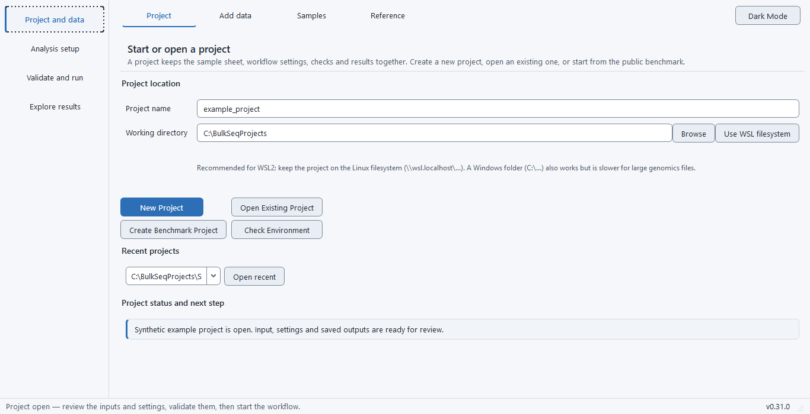

# BulkSeq Studio

[](https://github.com/tunabirgun/bulkseq-studio/releases) [](https://www.python.org/) [](https://snakemake.readthedocs.io/) [](LICENSE) [](https://github.com/tunabirgun/bulkseq-studio/actions/workflows/tests.yml)

BulkSeq Studio is a desktop application for Windows and Linux that manages bulk RNA-seq and microarray analyses through a recorded Snakemake workflow. Start from FASTQ files, public accessions, raw count matrices, supported microarray inputs or imported differential-expression results.

[Download from official releases](https://github.com/tunabirgun/bulkseq-studio/releases/latest) · [Handbook](https://tunabirgun.github.io/bulkseq-studio/) · [Changelog](CHANGELOG.md)



## Install and run

Use an official x86-64 Windows or Linux package and follow the [installation guide](https://tunabirgun.github.io/bulkseq-studio/guide.html). Local Windows analysis requires WSL2; the automatic installation route needs Windows 10 build 19041 or later, or Windows 11. The Linux AppImage requires glibc 2.38 or newer. No supported macOS installer or verified native analysis backend is available. Windows packages are unsigned.

1. Run **Check Environment** and resolve reported backend problems.
2. Create a project outside the application directory; review the input route, sample sheet, reference, comparison direction and resources.
3. Save settings, run **Validate current run inputs**, inspect the dry-run plan, then select **Start Run**.
4. Open the results report and read its recorded checks before interpreting tables or figures.

The [tutorial](https://tunabirgun.github.io/bulkseq-studio/tutorial.html) explains the interface. [Synthetic example reports](https://tunabirgun.github.io/bulkseq-studio/examples/standard/results/reports/results_report.html) illustrate report reading, not biological validation.

## Command line and HPC

The `bulkseq` command runs the same workflow as the interface. On a Slurm cluster, install both the analysis environment (`scripts/setup_wsl_bioenv.sh full`) and the command (`pip install -e .` from a source checkout) on the Linux login node, set the site settings in the project's configuration before the first run, and submit from there:

```bash
bulkseq config set -C PATH execution.slurm_partition short
bulkseq run -C PATH --exec-profile slurm
```

Do not edit the copied `workflow/profiles/site/slurm/config.yaml`; a changed workflow copy stops the project from running. Steps that need the internet run on the login node by default. Slurm submission was verified on a single-node test cluster, not on a production cluster, and Kubernetes execution is unverified. See [Command line and HPC](https://tunabirgun.github.io/bulkseq-studio/cli.html#hpc).

## Analysis boundaries

DESeq2, edgeR, limma-voom and microarray limma have different supported design formulas. Inputs, annotation coverage and backend availability determine which modules can run. Review the [input](https://tunabirgun.github.io/bulkseq-studio/inputs.html), [engine](docs/engines.html) and [interpretation](https://tunabirgun.github.io/bulkseq-studio/interpreting.html) guides; syntax acceptance does not establish a suitable scientific model.

Cross-study analysis requires compatible study-level inputs, at least two eligible studies and at least two samples per arm within each. Its restricted per-study model cannot substitute for a joint model with necessary covariates. Combined-p and pooled-effect outputs use different testing families. See the [cross-study guide](https://tunabirgun.github.io/bulkseq-studio/meta-analysis.html).

Missing or failed results are unavailable, not zero findings. Preserve the project configuration, checks, logs and accompanying outputs; links in an HTML report can depend on those files. See [checks](https://tunabirgun.github.io/bulkseq-studio/checks.html) and [outputs](https://tunabirgun.github.io/bulkseq-studio/outputs.html).

## Updates

**Release status:** This documentation describes version 0.36.0, which adds Slurm submission from the command line without changing 0.35.x statistical methods or scientific output; bundled biological datasets were not rerun for this release. Review [version notices](https://tunabirgun.github.io/bulkseq-studio/faq.html#version-notices), [scientific changes](CHANGELOG.md) and the [upgrade guide](https://tunabirgun.github.io/bulkseq-studio/upgrade.html) before reusing older results. Pre-0.35.0 alternative-engine/enrichment outputs and pre-0.34.0 pooled-effect adjusted values may need review and recomputation. Upgrading does not revise historical results.

Close the app before installing an update, retain the original project, and rerun input validation. Source installation requires Python 3.11+ and PySide6 6.11.2+; see [CONTRIBUTING.md](CONTRIBUTING.md) for development.

## Citation and support

Use [CITATION.cff](CITATION.cff), recording the version actually used. Ask usage questions in [Discussions](https://github.com/tunabirgun/bulkseq-studio/discussions) and report bugs in [Issues](https://github.com/tunabirgun/bulkseq-studio/issues).

Licensed under [MIT](LICENSE).
